# Thunder-X: architecture v2

The system as built. Green = what a version adds. Dashed = planned, not built yet.

---

## 1. How it grew: one step, from naive to mature

### v0 · ask an AI

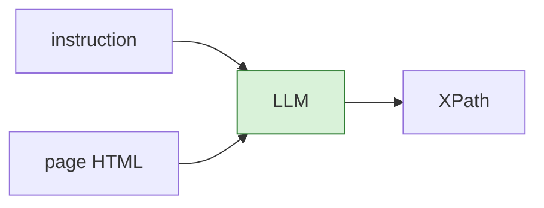

**Problem:** it invents XPaths that match nothing. Slow, costly, and we can't tell if it's right.

### v1 · pick a real element, write the XPath with code

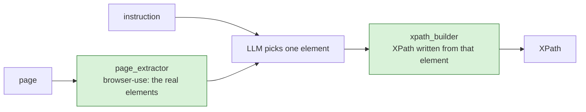

**Problem:** an LLM call for every step, even "click on About us".

### v2 · rules first

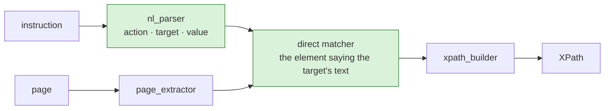

**Problem:** "hover over ok under Employee": two "ok" on the page.

### v3 · use the "where"

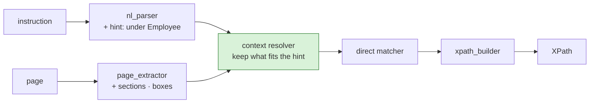

**Problem:** synonyms, icons, vague wording: still 0 or 2+ matches.

### v4 · a small AI only when the rules can't decide

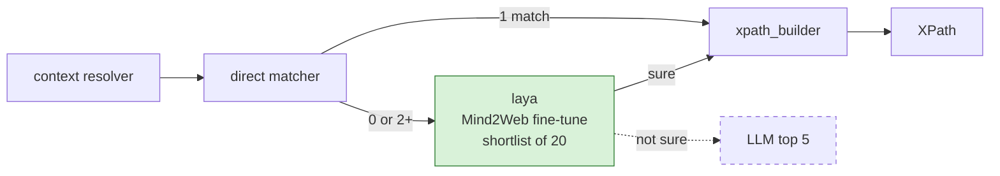

**Problem:** the XPath was never run: it may match 2 elements, the wrong one, or nothing.

### v5 · run it before trusting it

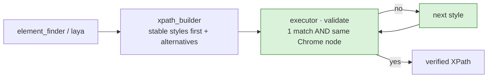

**Problem:** nothing happens on the page: step 2 runs on the same page as step 1.

### v6 · do the action

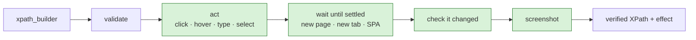

**Problem:** nobody sees what happened, and nothing is remembered.

### v7 · show it, record it

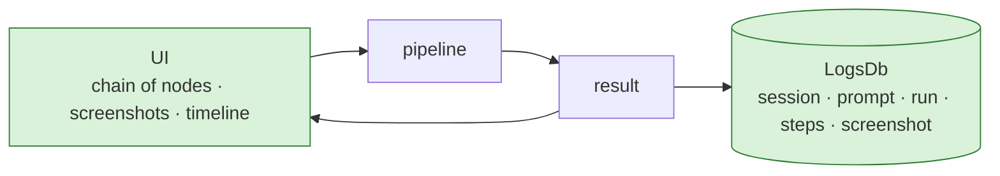

**Problem:** the confidence isn't measured: 1.0 for the rules, Laya's own number for Laya.

### v8 · measure it

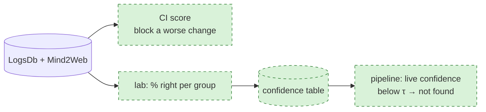

**Where we are:** v7 built, v8 designed (§13).

---

## 2. The whole picture

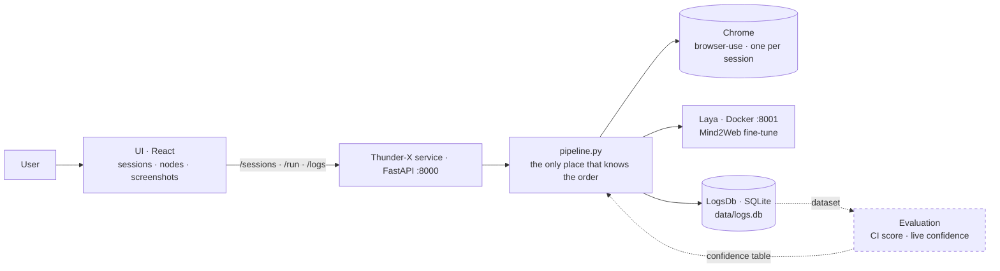

---

## 3. One step, end to end

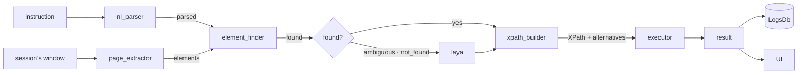

---

## 4. What travels between the parts

Each part adds one thing; nothing is invented on the way.

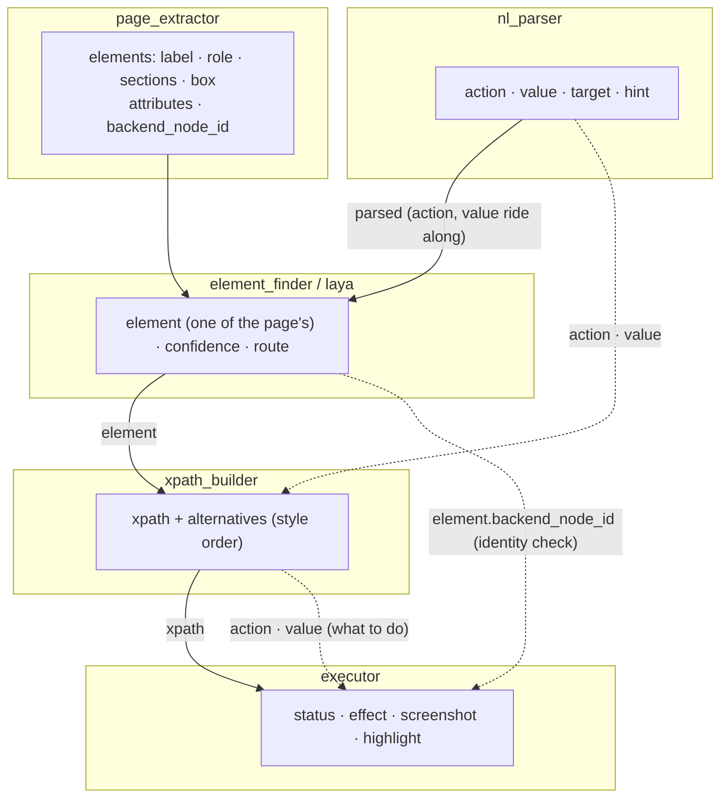

| Field in the final result | Comes from |
|---|---|
| `action`, `value` | nl_parser |
| `confidence`, `route` | direct matcher (1.0) or Laya |
| `xpath` | xpath_builder, **verified** by the executor |
| `status`, `effect`, `screenshot` | executor |

---

## 5. nl_parser: rules only

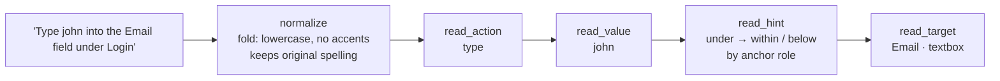

---

## 6. page_extractor: the page as a list

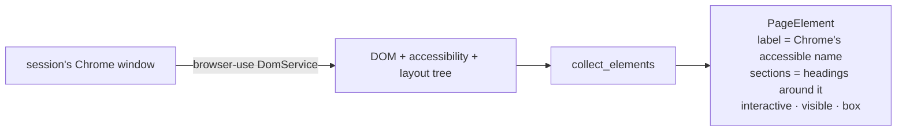

---

## 7. element_finder: where, then what

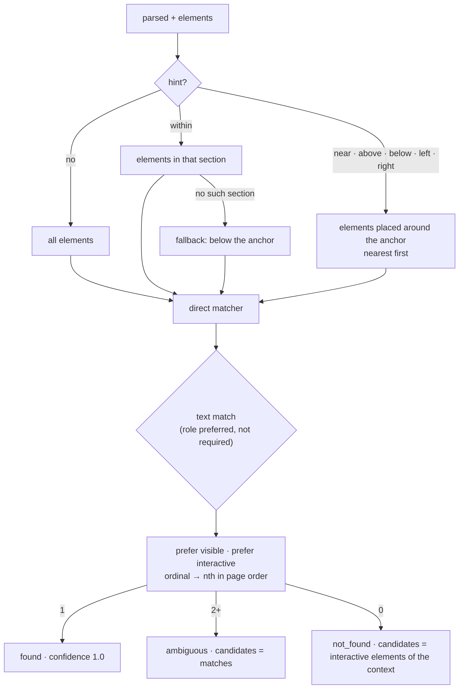

---

## 8. laya: only when the rules can't decide

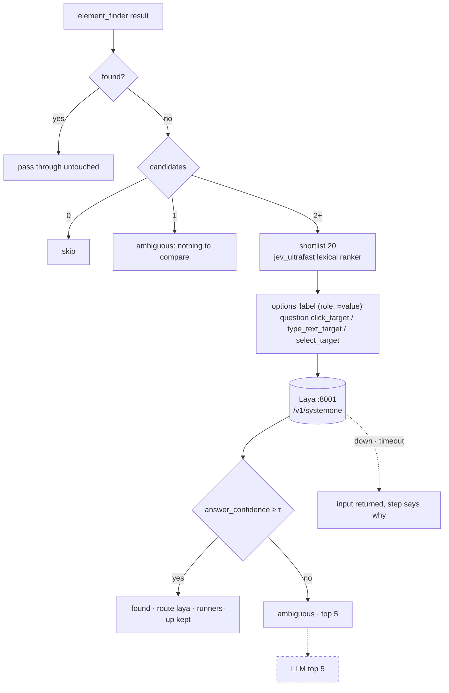

---

## 9. xpath_builder: write, don't run

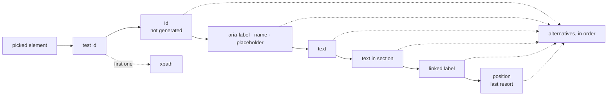

SVG elements are named by `local-name()`.

---

## 10. executor: run it, then (act mode) do it

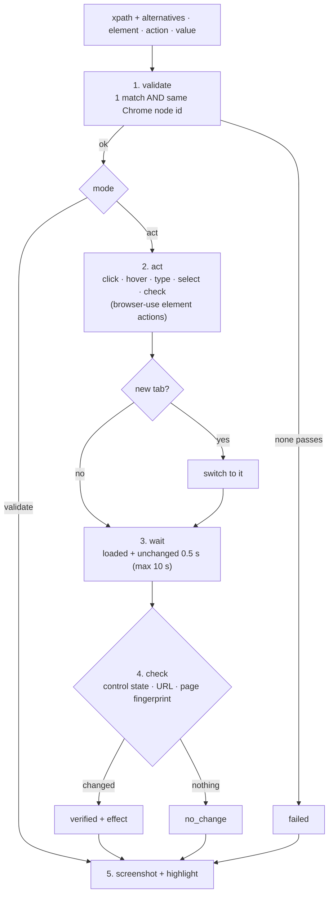

---

## 11. A session in the UI

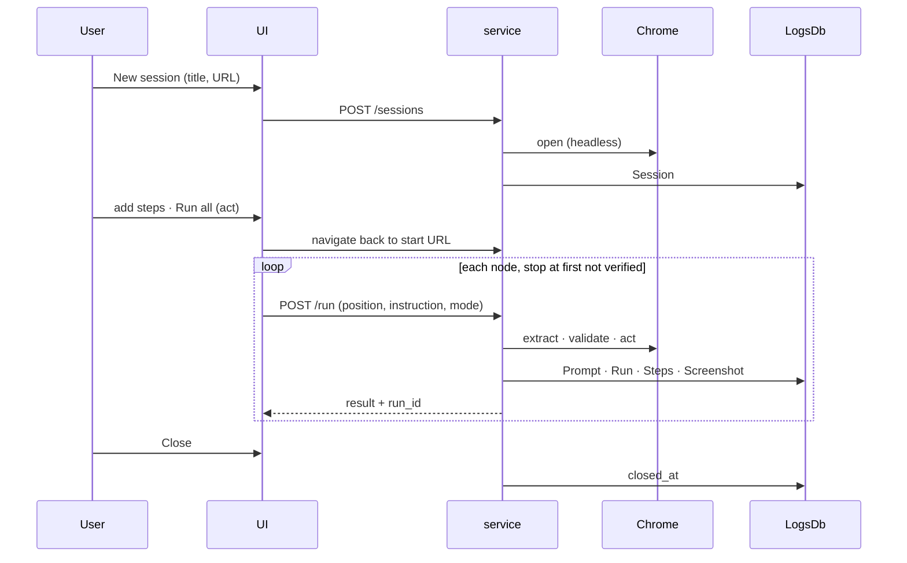

---

## 12. LogsDb

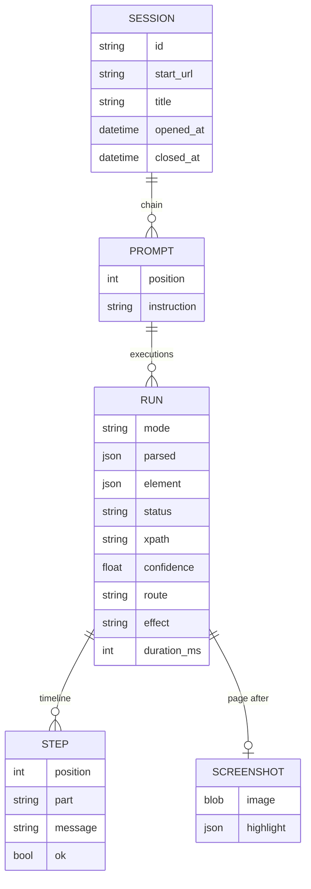

---

## 13. Evaluation: two systems

```mermaid
flowchart LR
    M2W[(Mind2Web<br/>+ own cases)] --> RUN[run the pipeline]
    RUN --> RES[(results)]
    RES --> CI[1 · CI score]:::planned
    RES --> LAB[2 · live confidence]:::planned
    classDef planned stroke-dasharray: 5 5
```

### 13.1 CI: score the system

```mermaid
flowchart LR
    R[results] --> CMP[compare to ground truth]
    CMP --> K[KPIs<br/>accuracy · precision · coverage]
    K --> SC[overall score]
    SC --> G{better or equal<br/>than main?}
    G -->|yes| SHIP[merge]
    G -->|no| BLOCK[block]
```

### 13.2 Live confidence: the lab, then runtime

```mermaid
flowchart TB
    subgraph LAB[lab · offline]
        R[results + right/wrong] --> COR[correlation of each column with right/wrong]
        COR --> PICK["pick group-by columns<br/>few · no duplicates · strongly correlated · available live"]
        PICK --> GRP[% right per group<br/>train split → check on test split<br/>≥ 30 examples per group]
        GRP --> TBL[(confidence table)]
    end
    subgraph LIVE[runtime]
        NEW[new prompt's run] --> KEY[its group]
        KEY --> LOOK[look up the table]
        TBL --> LOOK
        LOOK --> CONF[confidence = that group's % right]
        CONF --> TAU{≥ τ?}
        TAU -->|yes| OK[answer]
        TAU -->|no| NF[NOT_FOUND / next route]
    end
```

---

## 14. Where things run

```mermaid
flowchart LR
    subgraph HOST[./run.sh all]
        V[Vite UI :5173] -->|/api proxy| S[FastAPI :8000]
        S --> C[(Chrome · headless)]
        S --> F[(data/logs.db)]
    end
    S --> D[Docker: Laya :8001<br/>volume laya-models]
```
