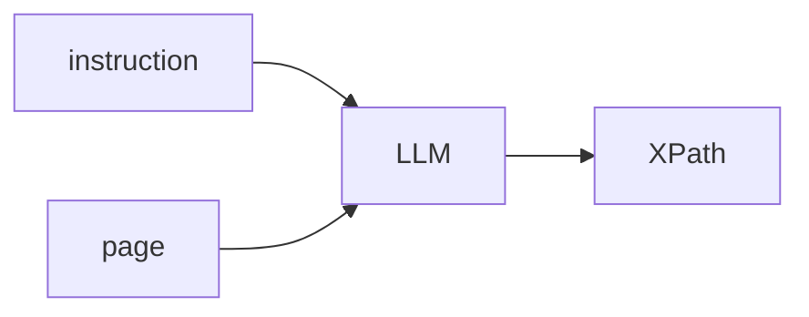
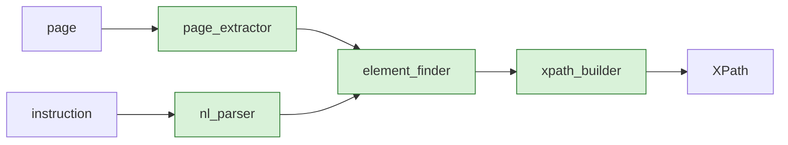
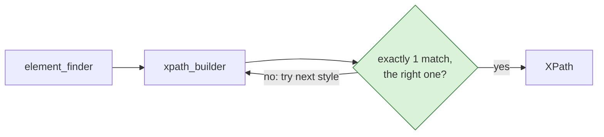
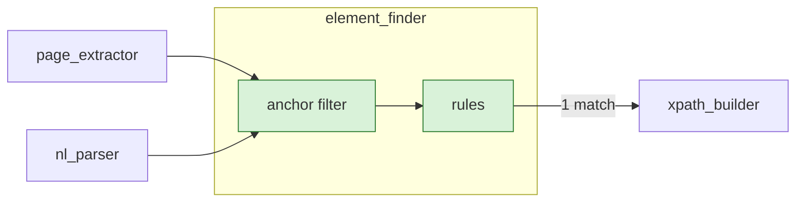
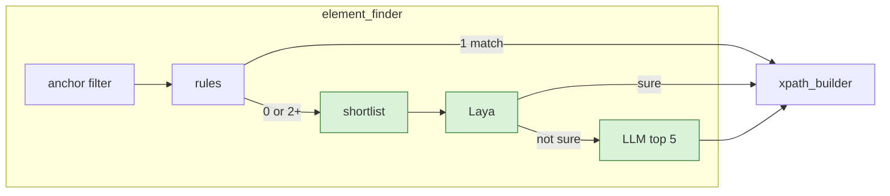
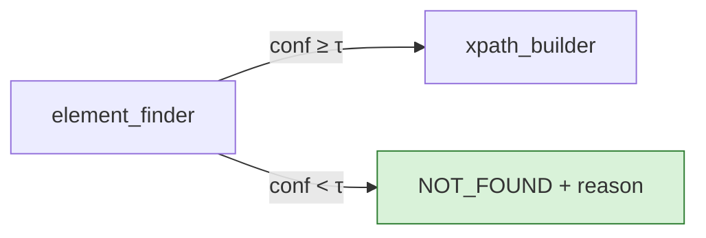
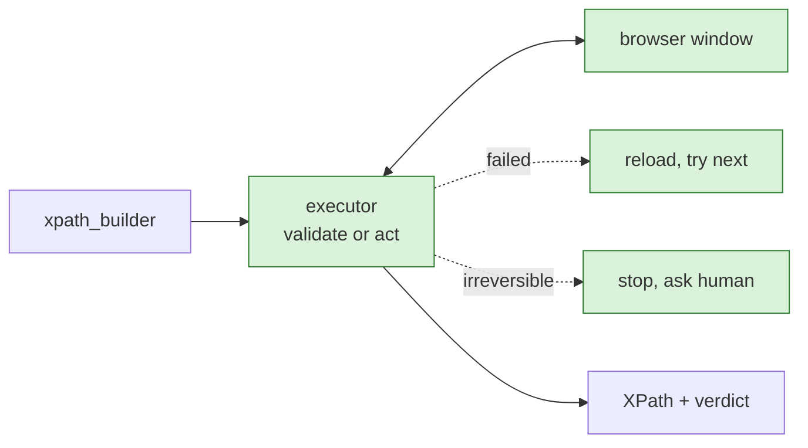
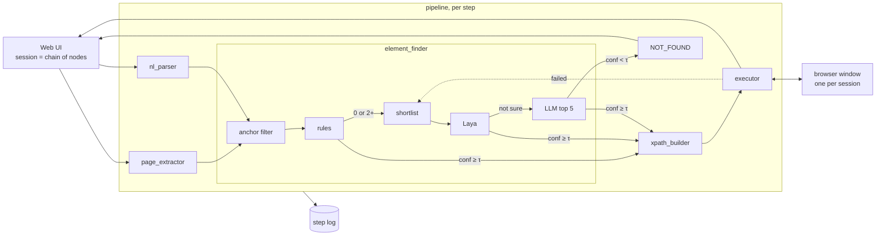
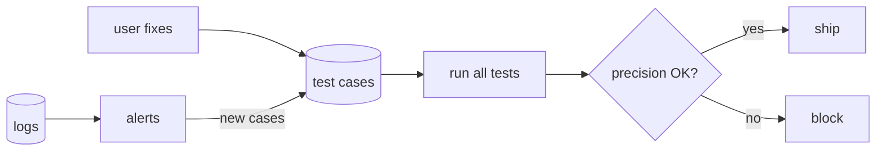
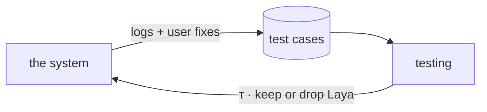

# NL → XPath: design

**Goal:** turn `"Hover over 'ok' under 'Employee' section"` + the open page into **one XPath that we tested on that page**, or an honest `NOT_FOUND`.

**Stack:** Python · **browser-use** (drives Chrome) · Laya (small model) · an LLM · FastAPI · React

**Three rules**
1. Never return an XPath we haven't run on the page.
2. Cheapest method first. AI only when needed.
3. A wrong answer is worse than "not found".

> In the diagrams, green = what that step adds.

---

## 1. What browser-use does for us

browser-use is an open-source framework that drives Chrome. **We reuse it, we don't rebuild it.**

| browser-use gives us | We add |
|---|---|
| A real Chrome window that stays open | One window per run, kept open across steps |
| The page as a list of elements (role, name, visible or not) | A readable label and section for each element |
| Actions: click, hover, type, select | A check that the action really worked |
| An LLM wrapper | The question we ask it |
| Its own XPath, based on position (`body/nav/a[2]`), so it breaks easily | **Stable XPaths** |
| `get_element_by_prompt` | Used as the baseline to beat |

---

## 2. Building the system, one problem at a time

### Step 0: the naive version

Give the page and the instruction to an LLM, ask for an XPath.



**Problem:** it can invent XPaths that match nothing. It's slow and expensive. We can't tell if it's right.

---

### Step 1: pick a real element, then write the XPath with code

- `page_extractor` (browser-use) lists the real elements on the page.
- `nl_parser` reads the instruction: action, target, hint ("under 'Employee'").
- `element_finder` picks one element from the list.
- `xpath_builder` writes the XPath **from that element**. Nothing is invented.



**Problem:** the XPath could match 2 elements, or break next week.

---

### Step 2: test the XPath on the page

`xpath_builder` tries the most stable styles first, and keeps the first one that **matches exactly 1 element, the right one**:

`data-testid` → `id` → `aria-label` / `name` → text → text inside its section → linked label → position (last resort)



**Problem:** how does `element_finder` pick? An LLM every time is slow and costly, and most steps are easy.

---

### Step 3: simple clues first (anchor filter + rules)

Take this page:

```html
<nav>
  <a>Home</a>
  <a>About us</a>
</nav>

<section>
  <h2>Employee</h2>
  <span>ok</span>          ← A
</section>

<section>
  <h2>Manager</h2>
  <button>OK</button>      ← B
</section>

<label for="c">Country</label>
<select id="c">…</select>  ← C
```

**Rules: find the element by its text.**
"Click on 'about us'" → one element says "About us" → **done**, no AI.
Rules get stuck when there are 2 matches ("ok" matches A and B) or none ("sign in" vs a "Log in" button).

**Anchor filter: use the "where" hint.**
It runs **before** the rules and removes elements that don't fit the hint.
- "Hover over 'ok' **under 'Employee'**" → keep only the Employee section → only A left → rules find "ok" → **done**.
- "Select the dropdown **next to 'Country'**" → keep the control linked to the "Country" label (`<label for="c">`) → C → **done**.

```text
all elements ──► anchor filter ──► rules ──► 1 match  → done
                 (where?)          (what?)   0 or 2+  → AI (next step)
```

> **In one line:** "We use the clues in the sentence, where and what, to narrow down the page. We only call AI when those clues aren't enough."



**Problem:** rules fail on synonyms, icons and vague wording.

---

### Step 4: a small AI, then a big one

- **Shortlist:** keep the ~20 most likely elements.
- **Laya** (small, fast model) picks one, with a confidence score.
- **LLM** only if Laya isn't sure. It sees just the top 5.



**Problem:** AI can be confidently wrong.

---

### Step 5: allowed to say "I don't know"

Every answer must pass a confidence threshold **τ**. τ is set by testing (§3), not by hand. Below τ → `NOT_FOUND` + why ("2 'Save' buttons, which one?").



**Problem:** a unique XPath can still point to a hidden element, or one covered by a cookie banner.

---

### Step 6: check it in the browser

`executor` (browser-use actions), two modes:
- **validate:** visible, enabled, not covered. No action, safe on real apps.
- **act:** do it, then check something changed (page, menu, value, tooltip).

If it fails: try the next candidate. If the failed click already changed the page, reload first. If it may have done something irreversible (submitted a form), **stop and ask a human**.



**Problem:** the user can't see what happened, so they can't trust it.

---

### Step 7: let the user watch

- A **web UI** where a session is a **chain of nodes**: one node per prompt (§5).
- One **real browser window** per session that **stays open between nodes**: node 2 starts where node 1 left off.
- Wrong pick? The user clicks the right element. That becomes a new test case (§3.9).

### Final runtime diagram



Also built in: French instructions, iframes, custom dropdowns, and personal data removed before anything goes to the LLM.

---

## 3. Testing: how we know it works

### 3.1 The idea: an exam with an answer key

We collect many examples where **we already know the right answer**. We run the system on them and count how often it's right. Exactly like grading an exam.

### 3.2 One test case, start to finish

A test case has three parts:

| Part | Example |
|---|---|
| **A saved page** | a copy of the Employee page (saved, so it never changes) |
| **An instruction** | "Hover over 'ok' under 'Employee' section" |
| **The answer key** | the `<span>ok</span>` in the Employee section, marked in the saved page |

We run the normal pipeline on it, with no window. Three possible outcomes:

```text
system picks the marked <span>ok</span>     → ✅ RIGHT
system picks the <button>OK</button>        → ❌ WRONG
system says NOT_FOUND                        → ⏸ NO ANSWER
```

We mark the **element**, not the XPath, because several XPaths can point to the same right element.

### 3.3 From 100 cases to two numbers

Say we run 100 cases and get: **80 right, 5 wrong, 15 no answer.**

- **Coverage** = how often we answer = 85 / 100 = **85%**
- **Precision** = when we answer, how often we're right = 80 / 85 = **94%**

**Why two numbers and not just "accuracy"?** Compare two systems:

| | Answers | Right | Wrong | Precision |
|---|---|---|---|---|
| System X | 100 | 90 | **10** | 90% |
| System Y | 85 | 84 | **1** | 99% |

X looks better on accuracy (90 vs 84). But X's 10 wrong answers turn into **bad tests that nobody notices**. Y's 15 "no answers" go back to the user, who fixes them in seconds. **For test automation, Y is better.** So our main score is: **precision, at a given coverage**.

### 3.4 τ: the knob between "answer more" and "be more sure"

τ is the minimum confidence needed to answer. Turning it up means fewer answers, but more of them are right:

| τ | Coverage | Precision |
|---|---|---|
| 0.5 | 95% | 90% |
| 0.7 | 85% | 97% |
| 0.9 | 60% | 99% |

*(example numbers, not measured)*

We pick a target ("at least 98% precision"), then take **the lowest τ that reaches it**. That's how τ is set: by the tests, not by hand.

### 3.5 Practice exams vs the real exam

Each set of test cases is split in two:
- **dev** (practice exams): we use these to choose τ and other settings, as often as we like;
- **test** (the real exam): only used to report the final score.

If we tuned on the real exam, the score would look better than reality.

### 3.6 Other checks

- **Does the XPath last?** We change the saved page slightly (add a wrapper `div`, rename CSS classes, change generated ids) and check the XPath still finds the same element.
- **Speed and cost** per step.
- **Is it worth it?** Compare with simpler options: rules only, LLM only, and browser-use's own `get_element_by_prompt`. If our pipeline doesn't beat them, simplify. If Laya doesn't help, remove it.

### 3.7 Where the test cases come from

| Set | What | Why |
|---|---|---|
| **A. Thunders set** (~200 cases) | Real steps on real apps (Thunders test account + public practice apps like the OrangeHRM demo). **People** write the instructions, in English and French | **Main score**: closest to real customers |
| **B. Hard set** (~100) | Small pages we write, each with one known trap: duplicate labels, icon buttons, custom dropdowns, iframes, cookie banners, generated ids | Check each weak spot |
| **C. Paraphrases** | A and B reworded by an LLM (synonyms, typos, French), checked by a human | Wording shouldn't change the answer |
| **D. Mind2Web** | Public dataset of human actions on real websites | Compare with Laya's published scores. **Never the main score:** its instructions are whole tasks, it has no hover, and its wording comes from a template |

*Sizes are targets, not done yet.*

### 3.8 Running the tests automatically

Every time we change something (prompt, model, τ), all the tests run again. **If precision drops, the change doesn't ship.** Nobody has to remember to check.

### 3.9 Learning from real use

- **"Wrong element" button in the UI:** the user clicks the right element → saved as a new test case. Every mistake users see becomes a test.
- **Logs:** if XPaths start breaking on a customer's app, or more steps need the LLM, we get an alert. Those steps become new test cases too.



---

## 4. How testing and design connect

**They are one loop.** The system produces logs and user fixes → testing turns them into scores → the scores set τ and decide what stays in the system.



- **Same code:** testing runs the real system, just without the window. What we test is what we ship.
- **Every box in the design gets a question:**

| Box | Question | If the answer is bad |
|---|---|---|
| page_extractor | Is the right element in the list at all? | Fix extraction |
| anchor filter | Does it ever remove the right element? | Loosen it |
| rules | When they answer, are they right? | Tighten them |
| shortlist | Is the right element in the top 20? | Change the scoring |
| Laya | Better than going straight to the LLM? | **Remove Laya** |
| τ | Where should we stop answering? | **Set τ from the table in 3.4** |
| xpath_builder | Unique, right, and lasting? | Change the style order |
| executor | Does "verified" really mean it worked? | Stricter checks |

- **Find which box failed.** Each box logs what it did, so every wrong case points to one box:

```text
100 cases
 ├─  4 right element not extracted  → page_extractor
 ├─  5 not in the shortlist         → shortlist
 ├─  6 wrong pick                   → Laya / LLM
 ├─  3 other
 └─ 82 right
(example numbers, not measured)
```

Fix the biggest one first.

---

## 5. The UI: a session is a chain of nodes

- **Node** = one prompt from the user ("Click on 'about us'").
- **Session** = a series of connected nodes, run in order: a full test scenario.
- **One browser window per session.** It stays open the whole time. Each node runs on the page the previous node left behind.

### 5.1 The session view

```text
Session: "Approve employee"        URL https://app.example.com        [ ▶ Run all ]

 ┌───────────────────────┐    ┌───────────────────────┐    ┌───────────────────────┐
 │ 1 Click on 'about us' │───►│ 2 Hover 'ok' under    │───►│ 3 Select dropdown     │───► [ + ]
 │ ✅ rules · 0.99       │    │   'Employee'          │    │   next to 'Country'   │
 └───────────────────────┘    │ ● running…            │    │ ○ waiting             │
                              └───────────────────────┘    └───────────────────────┘
```

- **[ + ]** adds a new node at the end. It runs on the page as it is now.
- Node colours: ✅ done · ● running · ○ waiting · ⚠️ not sure · ❌ failed / not found.

### 5.2 Inside a node (click it to open)

```text
┌─ Node 2 · Hover 'ok' under 'Employee' ─────────┐   ┌─ Browser window (shared by the session) ──┐
│ XPath    //h2[…='Employee']/ancestor::         │   │  Home  About us                          │
│          section[1]//*[…='ok']   ✔ 1 match     │   │  Employee                                │
│ Route    anchor + rules · confidence 0.97      │   │  ┏━━━━━━━━━━━━━━━━━━━┓                   │
│ Verdict  ✅ VERIFIED                           │   │  ┃hover · rules 0.97┃                    │
│                                                │   │  ┗┳━━┓━━━━━━━━━━━━━━┛                    │
│ [ ▶ Run this node ]  [ Wrong element ]         │   │   ┃ok┃  ┌────────────────┐                │
├─ Timeline ─────────────────────────────────────┤   │   ┗━━┛  │Approve employee│                │
│ parsed   hover · "ok" · under "Employee"       │   │         └────────────────┘                │
│ anchor   5 elements → 1 inside "Employee"      │   │  Manager   [OK]                          │
│ rules    1 match → <span>ok</span>             │   │  Country [ -- ▾]                          │
│ xpath    ✔ 1 match                             │   └───────────────────────────────────────────┘
│ act      hover                                 │
│ verify   tooltip hidden → visible   ✅         │
└────────────────────────────────────────────────┘
```

**When a node runs, the user sees in the browser window:** a red box on the element → a short pause → the box disappears → the action happens → the node turns ✅ / ⚠️ / ❌.

### 5.3 Controls

| Control | Effect |
|---|---|
| ▶ Run all | Runs every node in order, in the same window |
| ▶ Run this node | Runs one node on the current page |
| Edit a node's prompt | That node and the ones after it are marked stale, because their page depended on it. Re-run from there |
| Wrong element | The user clicks the right element in the window → saved as a test case (§3.9) |
| Mode | `validate` (check only) or `act` |

---

## 6. Status

| | Status |
|---|---|
| browser-use reading the page, XPath checks, hover/select checks, highlight | ✔ tested |
| Laya (install, speed, accuracy) | not tested yet |
| Test sets, testing pipeline, UI | designed, not built |