## 1 . Demo
## 2 . Architecture: how it evolved

Each stage answers a question, and each stage **adds to** what's there: every diagram shows the whole system at that stage.
Green = what the stage adds. Dashed = planned, not built.

### v0 · ask an LLM

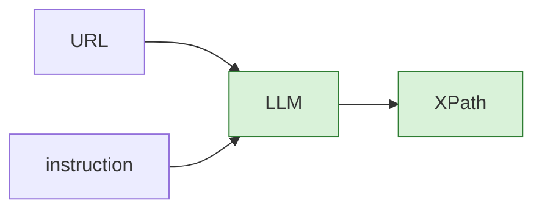

**Question:** an LLM can't open a URL, whatever its size, and it may invent an XPath that matches nothing.
**Answer:** read the page for it, and write the XPath with code.

### v1 · read the page for the LLM, write the XPath with code

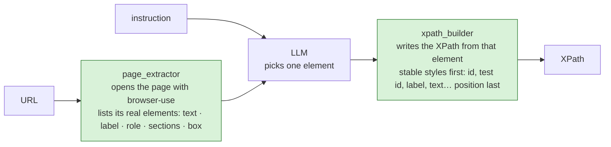

The LLM can only pick an element that exists, and the XPath is written by code: nothing invented.

**Question:** an LLM call for every step is costly, even for "click on About us".
**Answer:** two rule components in front of it: one that **filters** the page into candidates from the instruction, one that **finds the direct match**.

### v2 · rules first

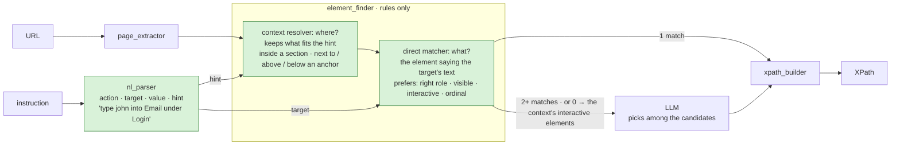

- **nl_parser** splits the sentence: "type **john** into the **Email** field **under the Login section**" → action `type`, value `john`, target `Email`, hint `within Login`.
- **context resolver** (where?) uses the hint to cut the page down: only the elements inside the "Login" section, or next to / above / below an anchor. If the hint isn't on the page, nothing is kept and the reason says why.
- **direct matcher** (what?) keeps the elements saying the target's text, then prefers the right role, visible, interactive ones, and picks the n-th one for "the second Save button".
  1 match → done, no AI. 2+ matches → they become the **candidates**. 0 match → the context's interactive elements become the candidates.

**Question:** the LLM is still costly on the steps the rules can't decide.
**Answer:** a **System 1** module that only takes a decision, with about 400M parameters.

> **System 1 model:** a small encoder with *decision heads* (here Laya, `convaiinnovations/laya`). It gets a text and a few typed questions ("which of these options?") and answers all of them in one forward pass, with a probability per option. It never generates text, so it's fast, cheap, runs on CPU, and can't invent an answer outside the options. More in `Documentations/laya-browser-mind2web.md`.

### v3 · a System 1 model decides when the rules can't

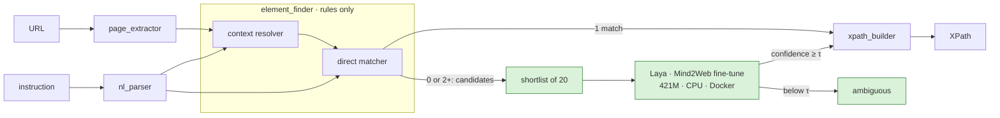

The LLM is gone from the pipeline: rules first, Laya second, on the matcher's candidates only.

**Question:** what if the XPath is wrong? It was never run.
**Answer:** test it on the page, then do the action and check it worked, with a screenshot. browser-use runs a silent (headless) browser session, kept open from step to step.

### v4 · test it, do it

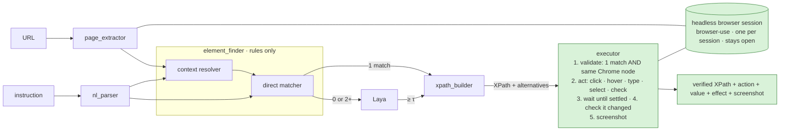

If a style fails validation, the executor tries the next one. Step 2 runs on the page step 1 left behind.

**Question:** to improve it and do research on it, we need to see what it did, and keep it.
**Answer:** log everything in a database, and show it.

### v5 · log everything

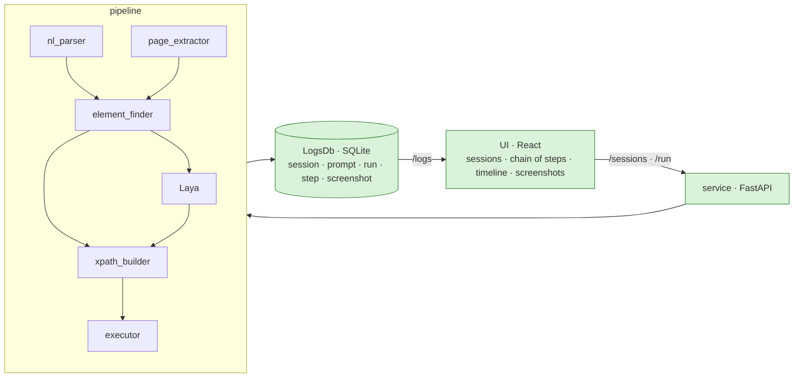

Every run keeps what each part did (its steps), the parsed instruction, the element, the XPath, the confidence, the route, the time and the screenshot.

**Question:** how good is it? We need a benchmark, and no public dataset fits the job (Mind2Web is whole multi-step tasks; MiniWoB++ is toy pages with one fixed sentence per task).
**Answer:** build one. A URL has its components: pick a component, generate its XPath and its instruction. That XPath is the goal; compare the system's answer to it.

### v6 · benchmark it on our own database

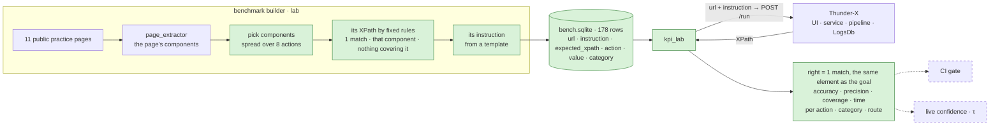

- **The goal is known by construction:** the component is picked first, the instruction written after.
- **Graded by execution, not by text:** two different XPaths can point to the same element.
- **8 actions:** click, double_click, right_click, hover, type, check, select, read.
- The same rows can be sent to large LLMs (GPT, Claude, Gemini) with the cleaned HTML, graded the same way.

**Question:** the labs show laya-browser does better. Can it do even better if it gets, straight from nl_parser and page_extractor, the data it was trained on, and is still called only when the matcher fails?
**Answer:** swap the Laya, and feed it what it was trained on.

### v7 · laya-browser, fed by the parser and the page

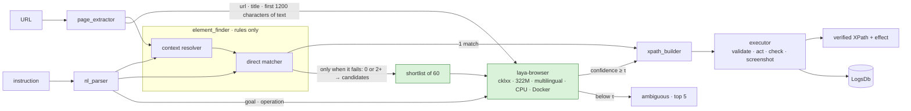

Same place as before, called only when the matcher fails. What changes: the model, and what it gets (the page's url, title and first 1200 characters of text, in its own training format).

On the v6 benchmark, same everything except the Laya:

| | Mind2Web Laya | laya-browser |
|---|---|---|
| precision | 68% | **74%** |
| accuracy | 67% | **70%** |
| coverage | **98%** | 94% |
| action accuracy | 78% | 78% |
| median time | **0.54 s** | 0.69 s |
| average time | **0.78 s** | 2.08 s |

laya-browser is the default: fewer wrong answers, for a few more "not found" and slower Laya steps.

**Where we are:** v7 built and default. v6 built: benchmark + KPI lab. Planned: CI gate, live confidence (τ is still a 0.3 placeholder), LLM fallback for the top 5.

---

## Architecture today

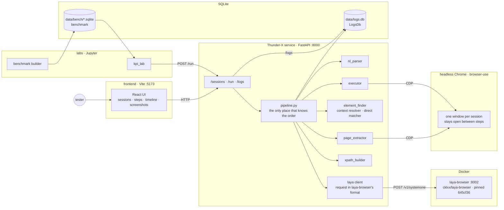

- **One service, one order:** `pipeline.py` calls the parts in order; each part is its own folder with its own router.
- **laya-browser** runs in Docker and is called only when the rules can't decide.
- **One headless browser window per session**, kept open: each step runs on the page the previous one left behind.
- **Two SQLite files:** LogsDb records every run; the benchmark holds the test cases. `kpi_lab` sends the benchmark rows to the service like any client.

# 3 . Evaluation framework

Two ways to measure: **online**, every run explains itself; **offline**, a benchmark with known answers.

## 3.1 Metrics

### Online: every run, in the UI and in LogsDb

| what | example |
|---|---|
| **status** | `verified` (1 match, the right element, and in act mode the action worked) · `no_change` · `failed` · `not_found` |
| **effect** of the action | "went to https://…", "the field holds 'john'", "it is checked" |
| **screenshot** | the page after the step, the element boxed |
| **every step, in detail** | what each part did: parser → context resolver → matcher → laya → xpath builder → executor |
| **route + confidence** | `direct_matcher · 1.00` or `laya · 0.71` |
| **time** | duration of the step |

### Offline: the benchmark (kpi_lab)

Each benchmark row is sent to Thunder-X (`POST /run`, validate mode). The answer is **right** when its XPath matches exactly one element, **the same element** as the row's expected XPath. Graded by execution, never by comparing text: two different XPaths can point to the same element.

| KPI | meaning |
|---|---|
| **accuracy** | right / all rows |
| **coverage** | rows where it gave an XPath / all rows |
| **precision** | right / rows where it gave an XPath: *when it answers, is it right?* |
| **action accuracy** | the action read from the sentence is the row's |
| **value accuracy** | the value read (text to type, option) is the row's |
| **time** | median · average · slowest, per step |

Also broken down **per action, per category and per route** (rules vs laya). Today, with laya-browser: **precision 74 % · accuracy 70 % · coverage 94 % · action accuracy 78 % · median 0.69 s**.

## 3.2 Dataset: how the benchmark was built

**Why our own:** no public dataset fits the job. Mind2Web is whole multi-step tasks for general web agents. MiniWoB++ is toy pages with one fixed sentence per task: only 20 of its 128 tasks passed our filter, 16 with a goal.

**The idea: target first, instruction second.** We never search for an element from a sentence. We pick an element, write its XPath, then write the sentence for it. The right answer is known by construction.

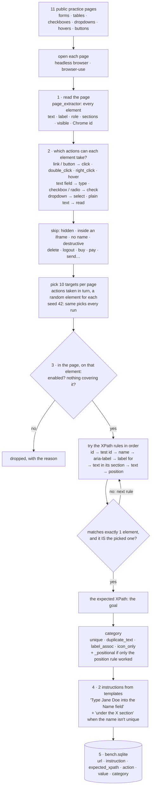

**Step by step:**

1. **Read the page.** Thunder-X's `page_extractor` lists every element, with what a person sees (text, label, section headings) and Chrome's own id for it.
2. **Pick targets.** Each element gets the actions its role allows. Hidden elements, elements in iframes, elements without a name (we couldn't describe them) and destructive ones are skipped. Then the actions are taken in turn, a random element for each, so the 10 targets of a page are spread across actions. Seeded: the same picks every run.
3. **Write the expected XPath, in the page.** On the element itself: it must be enabled, and once scrolled into view, the point at its centre must be the element (no overlay, no cookie banner). Then the rules, most stable first; ids and names containing a digit are skipped (they look generated). The first XPath that matches **exactly one element, and that element is the picked one**, becomes the goal. No rule passes → the target is dropped, with the reason.
4. **Write the instruction.** A few phrasings per action, 2 kept per target. When the name isn't unique for that action, the instruction says where: "… under the 'Data Tables' section". The value is chosen here too: a fake text to type, one of the dropdown's real options.
5. **Save** in one standalone SQLite file (written to a temporary file, then renamed: never half a file).

**What it produced:**

| | |
|---|---|
| rows | **178** (89 targets × 2 phrasings) on **11 pages** |
| per action | read 36 · double_click 32 · right_click 32 · click 30 · hover 20 · type 14 · check 12 · select 2 |
| per category | unique 122 · label_assoc 22 · positional (only the position rule worked): duplicate_text 26 · label_assoc 6 · unique 2 |
| dropped | 6 targets: 1 disabled field, 5 covered links (the "Fork me on GitHub" ribbon ×4, one menu link) |

Example rows:

| instruction | expected_xpath | action | category |
|---|---|---|---|
| Fill 'Username' with 'hello world' | `//*[@id='username']` | type | label_assoc |
| Right click the 'Sauce Labs' link | `//a[normalize-space()='Sauce Labs']` | right_click | unique |
| Choose 'One' from 'Dropdown (select)' | `//select[@name='my-select']` | select | label_assoc |
| Find the text 'Web form' | `//h1[normalize-space()='Web form']` | read | unique |

**Its limits (said up front):**
- Practice pages, simpler than a real customer app.
- Template sentences, values in quotes: easier to parse than what people write.
- It reads pages with Thunder-X's own `page_extractor`: an element it misses can never become a test case.
- 2 rows ask to type into a read-only field (the check only rejects disabled fields): a known fix.
- 34 expected XPaths are positional (`/html[1]/body[1]/…`): flagged by `_positional`, they break first when the page changes.

## 3.3 Quality checks

### Before an XPath is used: `thunderx/executor/services.py`

**Exactly one match, and the right element** (Chrome's own id, not a lookalike):

```python
async def match_on_page(cdp, xpath: str) -> tuple[int, int | None] | None:
    """How many elements the XPath matches, and Chrome's node id of the match when there's exactly one."""

    # document.evaluate(xpath, document, ...) is the browser's own XPath engine, run inside the page.
    # ORDERED_NODE_SNAPSHOT_TYPE asks for the list of ALL the elements the XPath matches, in page order.
    # json.dumps puts quotes around the XPath, so it can be pasted into JavaScript safely.
    search = f"document.evaluate({json.dumps(xpath)}, document, null, XPathResult.ORDERED_NODE_SNAPSHOT_TYPE, null)"

    # evaluate(): runs that JavaScript in the page through CDP (Chrome DevTools Protocol, how code drives Chrome).
    # .snapshotLength = how many elements matched.   by_value=True: send back the number itself.
    counted = await evaluate(cdp, f"{search}.snapshotLength", by_value=True)
    count = counted["result"]["value"]
    if count != 1:
        return count, None                      # 0 or 2+ matches: not good enough, no need to look further

    # .snapshotItem(0) = the one matching element.   by_value=False: send back a handle on it, not a copy.
    found = await evaluate(cdp, f"{search}.snapshotItem(0)", by_value=False)

    # DOM.describeNode (a CDP command): Chrome describes the element behind that handle,
    # including its backendNodeId: Chrome's own id for that exact element on this page.
    described = await cdp.cdp_client.send.DOM.describeNode(params={"objectId": found["result"]["objectId"]}, ...)
    return 1, described["node"]["backendNodeId"]
```

**Next style if not; none passes → `failed`.** An unchecked XPath is never returned:

```python
async def validate(result, built, element, browser) -> None:
    """The XPath, then its alternatives: the first one that matches only our element wins."""

    # xpath_builder wrote several XPaths for the element, most stable first: try them in that order.
    tries = [(built.style, built.xpath)]
    for option in built.alternatives:
        tries.append((option.style, option.xpath))

    for style, xpath in tries:
        match = await match_on_page(cdp, xpath)        # (count, Chrome id of the match): see above
        ...
        count, node_id = match
        if count != 1:                                 # 0 or 2+ elements: try the next XPath
            result.steps.append(f"executor: {style} ✘ {count} matches")
            continue
        # element.backend_node_id: Chrome's id of the element that was picked, saved by page_extractor.
        # Same id = the very same element on the page, not just one that looks the same.
        if node_id != element.backend_node_id:
            result.steps.append(f"executor: {style} ✘ 1 match, but another element")
            continue

        result.steps.append(f"executor: {style} ✔ 1 match, the right one")   # shown in the UI's timeline
        result.xpath = xpath                           # only a checked XPath is ever returned
        result.status = "verified"
        return

    # No XPath matched exactly this element: say so, rather than return a guess.
    result.status = "failed"
    result.reason = "no XPath matched exactly this element on the page"
```

**In act mode, the effect too:**

```python
    # After the action, look for a sign that it worked, in this order:
    #   1. the control itself (its value, checked state, selected option, read in the page)
    #      → "the field holds 'john'", "it is checked", "'Tunisia' is selected"
    #   2. else the page: before/after "fingerprints" (URL, title, number of elements, size of the HTML)
    #      → "went to https://...", "the page title is now ...", "the page changed"
    # Each check gives back a sentence, or None when it sees nothing.
    # `a or b`: keep a; if a is None, use b.
    effect = await expected_effect(result, target) or h.what_changed(before, after)

    if effect is None:                                  # neither saw anything: the action ran, but nothing shows it worked
        result.status = "no_change"
        result.reason = f"the {result.action} was done, but nothing changed on the page"
    else:                                               # a sign was found: the step stays "verified", with its effect
        result.effect = effect
```


## 3.4 Continuous improvement

**Everything is logged** in LogsDb, for every run: the instruction and how it was parsed, the element picked and the candidates' route, the XPath, the confidence, each part's steps, the status, the effect and the screenshot.

That data is the base for *(potential)*:
- **Research:** where does it fail? per action, per category, per route (rules or laya), per site.
- **Training:** real (page, instruction, right element) pairs to fine-tune the decision model on our own cases.
- **Human feedback:** a tester marks a step right or wrong in the UI → it becomes a new benchmark row.
- **Live confidence:** % right per group (route, category…) from the logs → a confidence score per answer, and τ set from data instead of the 0.3 placeholder.

# 4 . Behind the scenes

## 4.1 Time log: planned vs actual

| step | planned | actual | resources | description |
|---|---|---|---|---|
| **Read documents** | 4 h | 2 h | [w3schools · XPath](https://www.w3schools.com/xml/xpath_intro.asp) | XPath syntax |
| | | | [Mind2Web](https://osu-nlp-group.github.io/Mind2Web/) | dataset for developing and evaluating generalist web agents |
| | | | [browser-use](https://github.com/browser-use/browser-use) | open-source Python library for AI browser agents |
| | | | [dev.to · browser-use, Stagehand, Steel and Playwright MCP compared](https://dev.to/agdex_ai/ai-native-browser-automation-in-2026-browser-use-stagehand-steel-and-playwright-mcp-compared-160n) | article comparing the approaches |
| | | | *(diagram from the article)* | browser-use architecture: agent (Python / LLM) ↔ Playwright / Chromium, through an interactive DOM with annotated bounding boxes |
| | | 
| | | | [XPathia: a deep learning approach (thesai.org)](https://thesai.org/Downloads/Volume16No6/Paper_102-XPathia-A_Deep_Learning_Approach.pdf) | a deep learning approach to generating XPaths (28 % accuracy; not read to the end) |
| | | | **Datasets** | |
| | | | [MiniWoB++](https://github.com/Farama-Foundation/miniwob-plusplus) · [its human demos](https://github.com/stanfordnlp/miniwob-plusplus-demos) | 130 tiny web tasks with an instruction each, and 18,124 recordings of people doing them |
| | | | WebLINX · ScreenSpot · UGround / OS-Atlas training data | web element grounding sets: conversations, or screenshots with boxes (no DOM) |
| | | | **Products and models** | |
| | | | [Stagehand](https://github.com/browserbase/stagehand) (`observe()`) | page + instruction → XPath + action, through an LLM |
| | | | browser-use `page.get_element_by_prompt()` | page + prompt → an element, through an LLM |
| | | | MindAct: [candidate ranker](https://huggingface.co/osunlp/MindAct_CandidateGeneration_deberta-v3-base) · [action prediction](https://huggingface.co/osunlp/MindAct_ActionPrediction_flan-t5-base) | Mind2Web's own models: HTML + task → an element, no LLM |
| | | | [UGround-V1-2B](https://huggingface.co/osunlp/UGround-V1-2B) · [ShowUI-2B](https://huggingface.co/showlab/ShowUI-2B) · [Holo1.5-3B](https://huggingface.co/Hcompany/Holo1.5-3B) · [GUI-Actor-3B](https://huggingface.co/microsoft/GUI-Actor-3B-Qwen2.5-VL) | vision models: screenshot + instruction → a pixel (x, y) |
| | | | Large LLMs: GPT · Claude · Gemini | can't open a URL: the page's HTML has to be sent to them |
| | | | [convaiinnovations/laya](https://huggingface.co/convaiinnovations/laya) · fine-tunes: [Quantum08](https://huggingface.co/Quantum08/laya-browser-mind2web) · [cklxx](https://huggingface.co/cklxx/laya-browser) · ShaunSpark · abedinia | the System 1 model and 4 browser fine-tunes, compared before choosing |
| **Plan and architectures** | 4 h | 6 h | this GitHub repo · `Documentations/DesignV1.md`, `ArchitectureV2.md` | the design: 3 rules, the steps, the testing plan |
| **nl_parser** | 2 h | 2 h | `thunderx/nl_parser` | rules only: sentence → action · value · target · hint (English and French) |
| **page_extractor** | 2 h | 1 h 30 | `thunderx/page_extractor` · browser-use `DomService` | page → list of elements: text, label, role, sections, box, Chrome id |
| **context resolver + direct matcher** | 4 h | 4 h | `thunderx/element_finder` | where (hint → section / anchor), then what (the element saying the target's text) |
| **Laya setup** | 2 h | 2 h | [convaiinnovations/laya](https://huggingface.co/convaiinnovations/laya) · [Quantum08/laya-browser-mind2web](https://huggingface.co/Quantum08/laya-browser-mind2web) · `docker/laya` | the System 1 model in Docker (`laya-serve`), called when the rules can't decide |
| **XPath builder** | 2 h | 30 min | `thunderx/xpath_builder` | candidate XPaths, stable styles first, position last |
| **Executor** | 1 h | 1 h | `thunderx/executor` · browser-use actions + CDP | validate (1 match, same Chrome id) · act · check the effect · screenshot |
| **LogsDb** | 1 h | 1 h | `thunderx/logs_db` · SQLModel + SQLite | session · prompt · run · step · screenshot |
| **Benchmark & KPIs** | 2 h | forever (databases and all) | Mind2Web · [MiniWoB++](https://github.com/Farama-Foundation/miniwob-plusplus) · 11 public practice pages · `labs/` | public datasets reviewed and dropped → our own benchmark (178 rows) + `kpi_lab` |
| **New Laya and new architecture** | 2 h | 2 h | [cklxx/laya-browser](https://huggingface.co/cklxx/laya-browser) · `docker/laya-browser` | laya-browser fed with the page (url, title, 1200 characters) · precision 74 % vs 68 % |
| **Thunders research: business** | - | - | | |
| **Thunders: product research** | - | - | | |
| **Research about you guys** | - | - | | |
| **Documenting everything** | forever | forever | `Documentations/` | design, architecture, Laya, MiniWoB lab report, benchmark vs tools, this summary |


## 4.2 Dead ends, and what we dropped

- **Public datasets (THIS ONE)** (Mind2Web, MiniWoB++): built labs for both, dropped both → our own benchmark.
- **Gemini writing the benchmark's instructions** (plus a second Gemini call to check ambiguity): dropped for templates. Simpler, no API, reproducible.
- **A 21-action benchmark builder** (drag and drop, upload, iframes, shadow DOM…): too long to read and maintain → 8 actions, readable code.
- **The LLM after Laya** (top 5 → LLM): designed, not built: the goal was a system that runs without an LLM.
- **Quantum08's Laya as the default**: replaced by laya-browser once the benchmark showed better precision.

# 5 . Strategic vision

## 5.1 Thunders today, and where Thunder-X fits


### 01 · Tests in plain language

[product](https://www.thunders.ai/product): tests written in your own language, no scripts, from specs, user stories or a prompt.

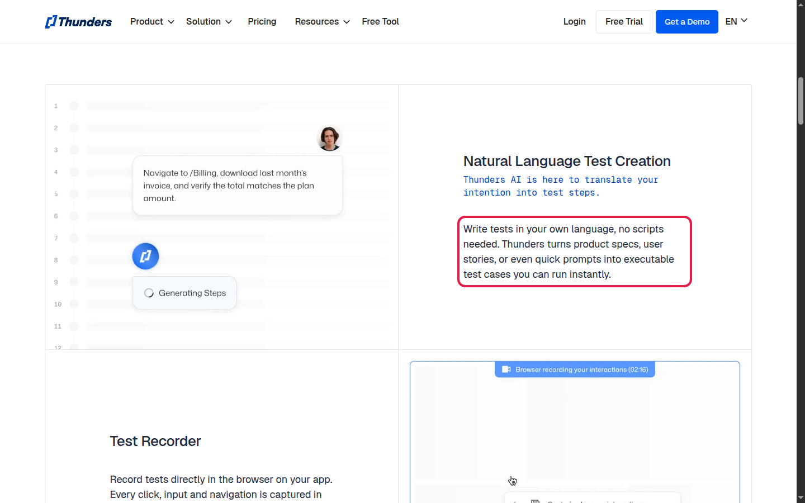

- **Thunders might need:** each sentence turned into an action on one element of the page.
- **Thunder-X gives:** URL + sentence → action + value + a **verified** XPath (1 match, the right element), or "not found".

### 02 · Intent, not buttons and selectors

[for QA](https://www.thunders.ai/for-qa): "Our AI understands flows and intent, not just buttons and selectors."

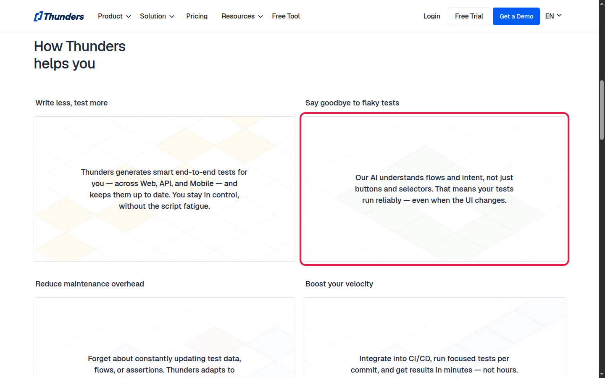

- **Thunders might need:** read what the tester means, and still end on exactly one element.
- **Thunder-X gives:** `nl_parser` reads the intent (action · target · where), the rules and laya-browser pick the element, the executor confirms it on the live page.

### 03 · Self-healing when the UI moves

[about](https://www.thunders.ai/about): "stable execution, self-healing when the UI moves, evidence on every step, and an audit trail".

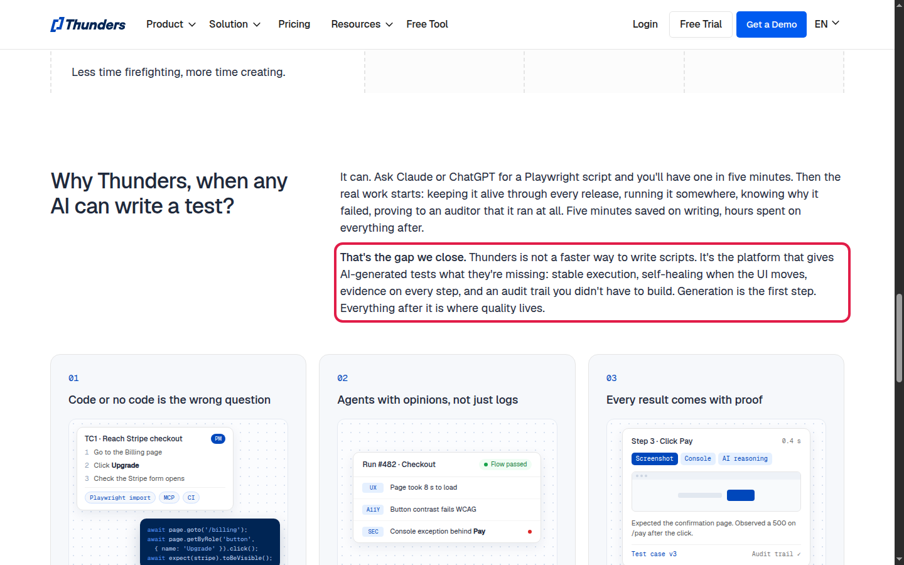

- **Thunders might need:** find the element again after the page changed.
- **Thunder-X gives:** the sentence stays the source: run it again → a new verified XPath. And XPaths that break less: stable styles first, generated ids skipped.

### 04 · AI agents with their own standard

[about](https://www.thunders.ai/about): QA, accessibility, UX and security agents, each holding the product to its own standard.

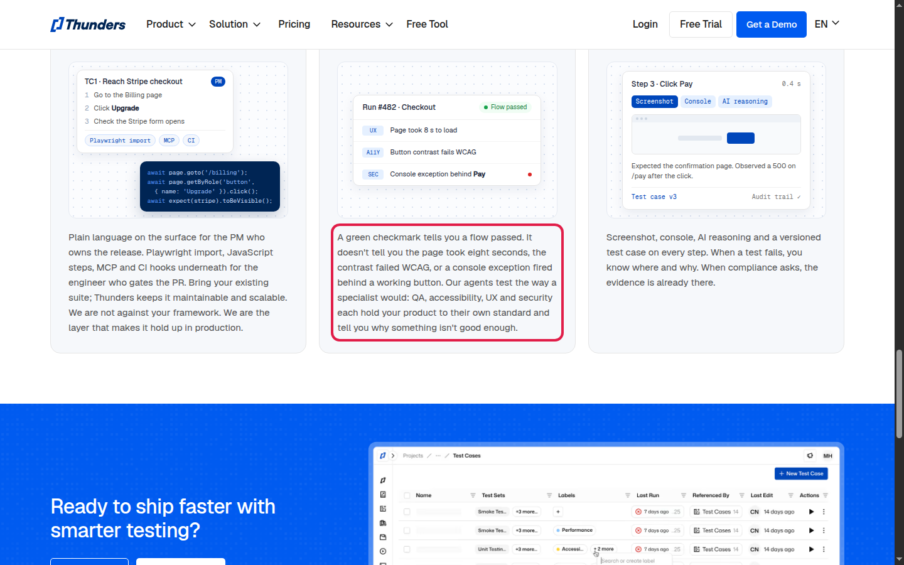

- **Thunders might need:** every agent acting on, and pointing at, the right element.
- **Thunder-X gives:** the same element step for every agent, each answer logged with its route and confidence, so a finding points to one exact element.

### 05 · Test Diff

[Thunders Connect 2026](https://www.thunders.ai/articles/thunders-connect-2026-exploring-the-future-of-ai-testing): compares test runs to find regressions and unexpected changes.

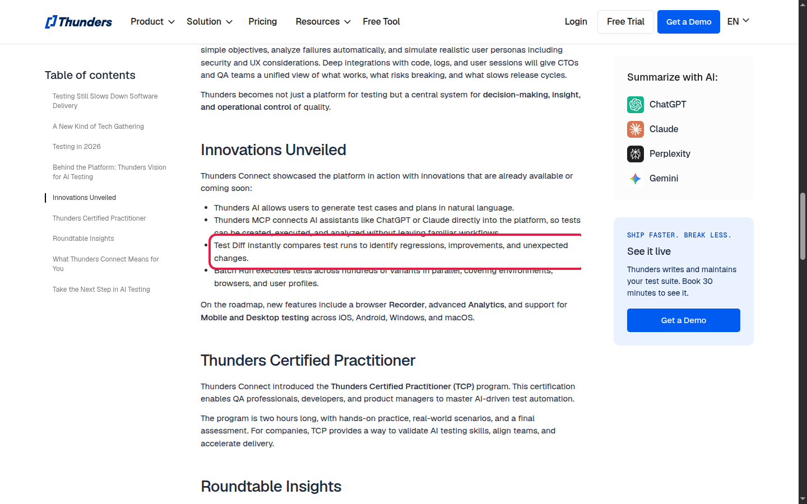

- **Thunders might need:** the same step, compared from one run to the next.
- **Thunder-X gives:** every step stored in LogsDb: element, XPath, route, confidence, status, effect, screenshot. Two runs can be compared step by step.

### 06 · Thunders MCP

[AI test generation](https://www.thunders.ai/product/features/ai-test-generation): create tests from Claude, ChatGPT, Cursor or any MCP assistant.

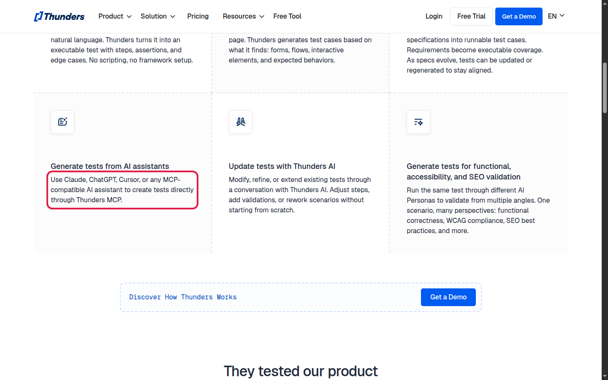

- **Thunders might need:** the step callable from any assistant or tool.
- **Thunder-X gives:** one HTTP call, `POST /run` (URL + sentence → XPath): easy to wrap as a tool.

### 07 · Playwright import and export

[about](https://www.thunders.ai/about): Playwright import, JavaScript steps, MCP and CI hooks for engineers.

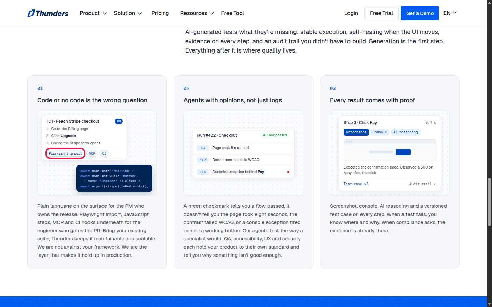

- **Thunders might need:** a selector a script can keep.
- **Thunder-X gives:** an XPath built to last (id, test id, label, text in its section), position only as a last resort.

### 08 · Web, API and mobile

[for QA](https://www.thunders.ai/for-qa): tests across web, API and mobile.

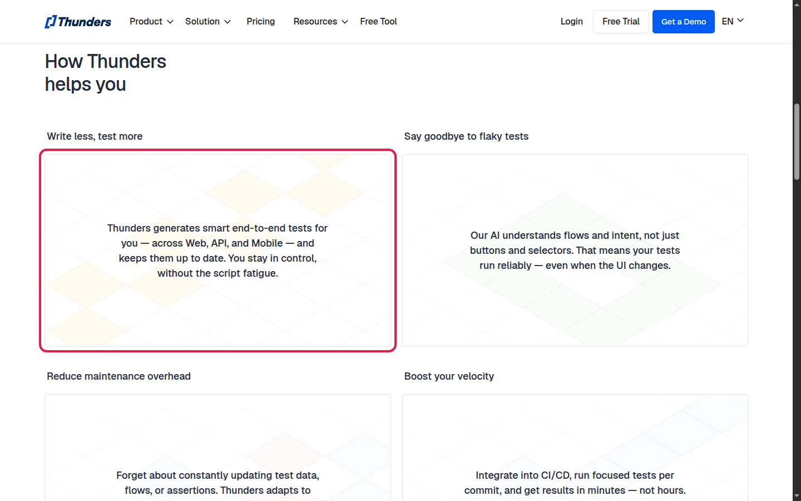

- **Thunders might need:** element finding on each platform.
- **Thunder-X gives:** the web part: any page a browser can open. API and mobile are not covered.

### 09 · Specialized models, thresholds, logs

[AI test generation, FAQ](https://www.thunders.ai/product/features/ai-test-generation): "models specialized in software testing rather than general-purpose LLMs", confidence thresholds, traceable logs.

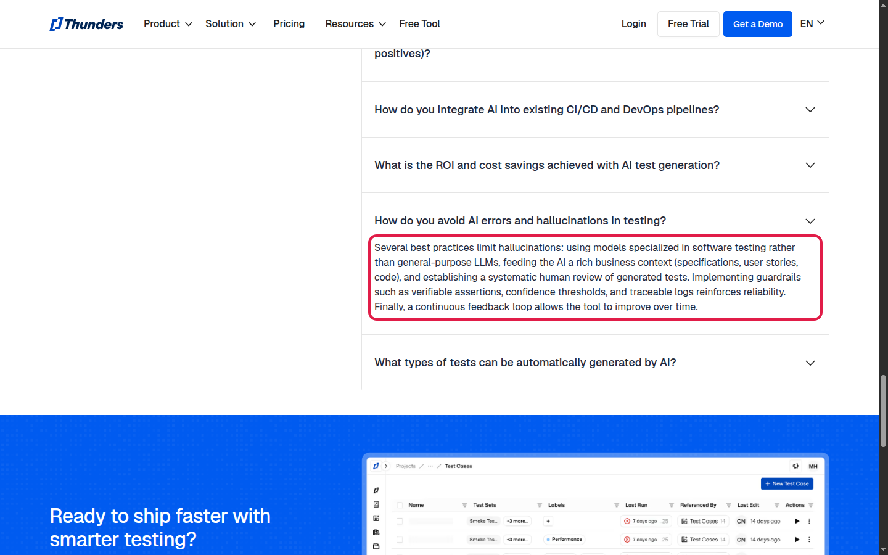

- **Thunders might need:** a decision that is cheap, explainable and auditable.
- **Thunder-X gives:** exactly that design: rules first, a 322M System 1 model only when they can't decide, a τ threshold, every step logged.


### 11 · €7.8M (≈ $9M) seed, June 2025

[Silicon Canals](https://siliconcanals.com/thunder-code-secures-7-8m).

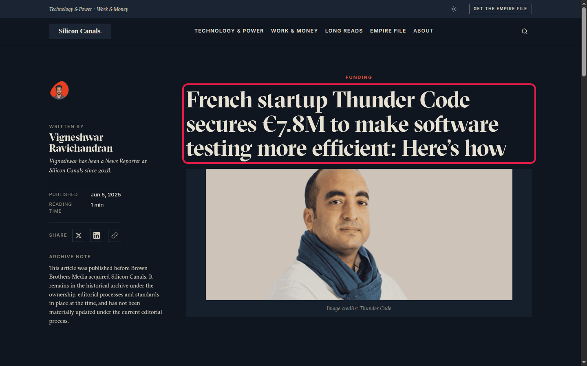

- **Thunders might need:** lets not spend them on tokens
- **Thunder-X gives:** no LLM call on the steps the rules solve, median 0.69 s per step on CPU.

Not public: how Thunders picks the element on the page at run time.

## 5.2 What comes next

**Vision: Thunder-X becomes the layer under every Thunders test that turns a sentence into the right element, proves it, and fixes it when the page changes.**

| horizon | goal | how | proof |
|---|---|---|---|
| **1 · Trust** (now) | every answer can be believed | confidence set from data, not by hand (τ = 0.3 today) · CI gate on the benchmark · real apps and French in the benchmark | a confidence of 0.8 is right 8 times out of 10 · no merge lowers precision |
| **2 · Zero maintenance** (next) | tests that repair themselves | a broken XPath → re-run the stored sentence, store the new verified one · a recorded click → a readable sentence | % of steps healed alone after a page update |
| **3 · Learns from use** (next) | it gets better with every customer | every run is already logged: tester feedback → new benchmark rows → fine-tune laya-browser on real Thunders steps | precision rising release after release |
| **4 · Any screen** (later) | no element out of reach | a vision model only for what the DOM can't name (canvas, bare icons) · the same rules-first idea on mobile screens | the "not found" cases shrink |


# 6 . Q&A

##trade-offs

- **Rules before AI:** fast, free and repeatable, but they miss synonyms and vague wording, so those go to laya-browser.
- **Precision before coverage:** we prefer "not found" to a wrong answer, so coverage is 94 % and precision 74 %.
- **laya-browser over the Mind2Web Laya:** +6 points of precision, but steps that reach Laya take longer (average 2.08 s vs 0.78 s).
- **A small model on CPU, no LLM:** no API cost and no data sent out, but it can't reason like a large LLM on hard sentences.
- **Stable XPaths first:** id, label, text in section survive a redesign; the position XPath always works but is the first to break, so it comes last.

## edge cases 

- **Two elements with the same text:** "under X" / "next to X" narrows them down; otherwise laya-browser picks; otherwise the step says it's ambiguous.
- **A wrong XPath (0 or 2+ matches, or another element):** the executor tries the next one; none left → `failed`, never a guess.
- **An element with no box of its own on hover:** the hover is skipped and the step says so.
- **laya-browser down or too slow (10 s):** the step continues with the rules' result and says why.
- **Not handled yet:** elements inside iframes or shadow DOM, which an XPath on the page can't reach.


one action instructions , not multiple and this is the most important pne

## Scaling challenges and solutions

- **One browser per session:** each one costs memory, so sessions run on a pool of workers with a limit per machine.
- **laya-browser on CPU:** one container is the bottleneck, so run several behind a load balancer, or a GPU (22–27 ms per decision per its model card).
- **Steps the rules answer never reach Laya:** only the ambiguous ones add model load (the per-route split in `kpi_lab` says how many).
- **LogsDb is one SQLite file with screenshots:** move it to Postgres, with screenshots in object storage.
- **More customers, more pages:** UI!
